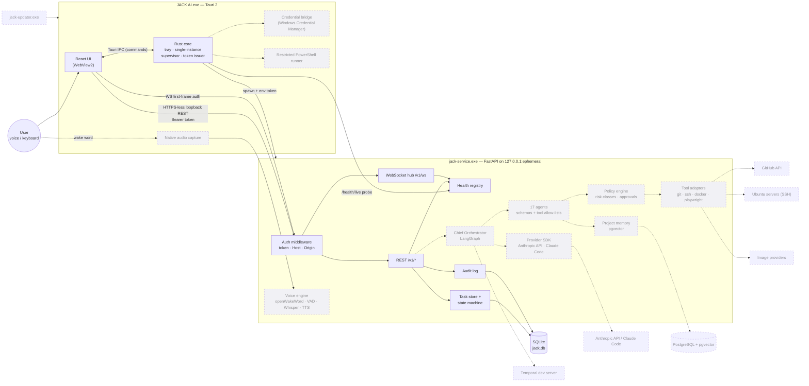

# JACK AI — Component Diagram

Deliverable 2 of Section 30. Solid boxes exist after Milestone 1; dashed (`:::planned`) are planned.

## Component responsibilities

| Component | Owns | Must never |
|---|---|---|
| React UI | Presentation, local view state | Persist secrets, call external services directly |
| Rust core | Process lifecycle, token issuance, OS integration, signature checks | Execute model-proposed commands without policy decision |
| Auth middleware | Token, Host and Origin validation, audit on failure | Log tokens |
| Health registry | Aggregated component status, change events | Block on a slow probe (each probe has a 2 s timeout) |
| Task store | Durable tasks + validated transitions | Allow a transition not in the state graph |
| Policy engine (M7) | Allow/deny/require-approval per tool call | Accept an approval not issued by the authenticated user |
| Orchestrator (M6–7) | Decomposition, scheduling, result review | Hold progress only in model context |
| Updater (M16) | Download, verify signature, swap install while app is stopped | Replace a running executable |
