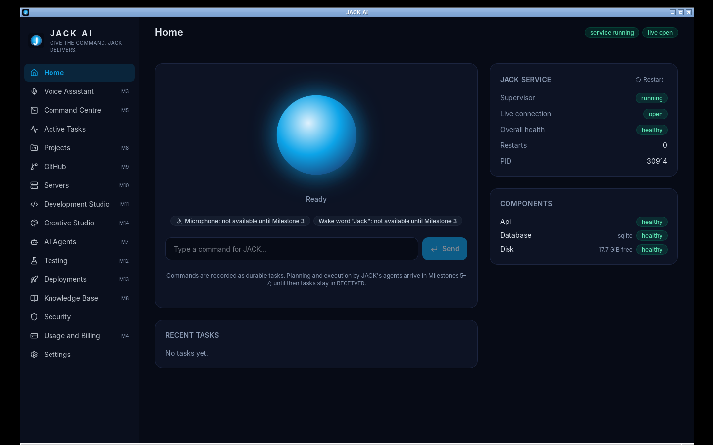
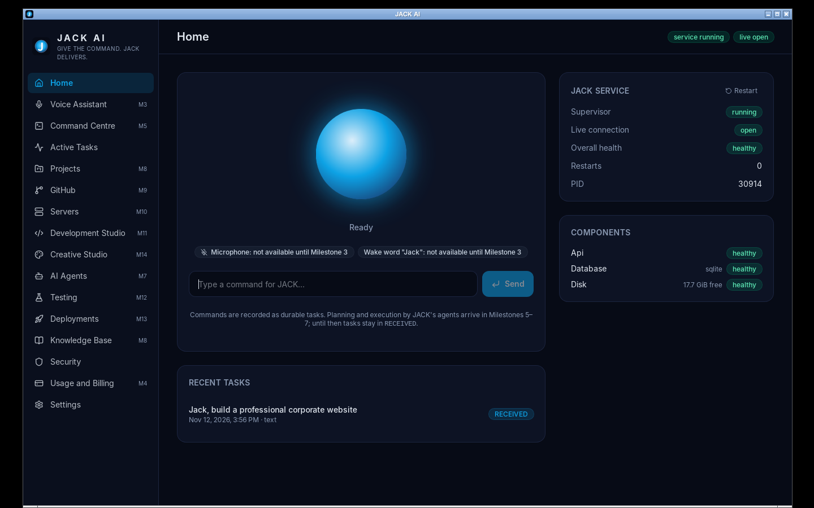

# Milestone 1 Report — Project Foundation

**Branch:** `dev/m1-foundation` · **Date:** 2026-11-12 · **Version:** 0.1.0 (developer preview)

## 1. Summary

Milestone 1 delivers the Section 30 design documents and a working foundation:

- A Tauri 2 desktop app whose Rust core supervises a local FastAPI service.
- The service is authenticated, loopback-only and recoverable after crashes.
- Commands become durable tasks with a validated lifecycle.
- A tamper-evident audit log.
- CI that builds the Windows installers.

Every claim below is backed by an evidence file in [`evidence/`](evidence/).

**Windows verification:** GitHub Actions run #1 (all 4 jobs green) built both installers on `windows-latest`. On Windows it ran the service tests (51 passed, 4 POSIX-only skipped) and the Rust supervisor integration test, which exercises the Job Object path with `taskkill /F`.
**Not yet verified:** installing `JACK-AI-Setup-x64.exe` / `JACK-AI-x64.msi` on a real Windows 10/11 machine and using the GUI there. CI builds the installers but does not install them. The GUI was verified end to end on the Linux release build (§2).

## 2. Test results (real runs, this commit)

| Suite | Result | Evidence |
|---|---|---|
| Service tests, SQLite | **55 passed** | [service-sqlite.txt](evidence/service-sqlite.txt) |
| Service tests, PostgreSQL 16 (pgvector image) | **55 passed** | [service-postgres.txt](evidence/service-postgres.txt) |
| ruff, mypy `--strict`, pip-audit | clean · no issues · no known vulnerabilities | [service-lint-audit.txt](evidence/service-lint-audit.txt) |
| Frontend (vitest) + `tsc` typecheck | **14 passed** · clean | [frontend-tests.txt](evidence/frontend-tests.txt) |
| Rust unit tests | **3 passed** | [rust-tests.txt](evidence/rust-tests.txt) |
| Rust integration test (real frozen service: start, SIGKILL, restart, token rotation) | **1 passed** | [rust-tests.txt](evidence/rust-tests.txt) |
| `cargo fmt`, `clippy -D warnings` | clean | [rust-lint.txt](evidence/rust-lint.txt) |
| `cargo audit` | **0 vulnerabilities**; 5 informational warnings (4 unmaintained, 1 unsound), all transitive through Tauri's Linux-only GTK/D-Bus stack (`glib`, `zbus`, `zvariant`, `proc-macro-error`) and not compiled into Windows builds | [rust-audit.txt](evidence/rust-audit.txt) |
| `pnpm audit --prod` | no known vulnerabilities | local run and CI job `frontend` |
| GitHub Actions CI (Linux ×3 + Windows) | **4/4 jobs passed** | [run #1](https://github.com/trinath94/jack-ai/actions/runs/43253918389) |
| Service tests on Windows | **51 passed, 4 skipped** (POSIX-only lifeline tests) | CI Windows job |
| Rust unit + integration tests on Windows (Job Object path) | **3 + 1 passed** | CI Windows job |
| **End-to-end, release build under Xvfb (Linux)** | **11/11 passed** | [e2e-linux-smoke.txt](evidence/e2e-linux-smoke.txt), screenshots below |

### M1 acceptance criteria (`docs/architecture/ACCEPTANCE_TESTS.md`)

| # | Criterion | Status |
|---|---|---|
| 1 | Refuses to bind to a non-loopback host | ✅ unit tests and the real process (exits with code 2) |
| 2 | Unauthenticated `/v1/*` → 401 and an audit row | ✅ |
| 3 | Wrong `Host` → 421 | ✅ test client and real `curl` |
| 4 | WebSocket auth frame required (4401); foreign origin rejected (4403) | ✅ |
| 5 | Task create/list/transition; invalid → 409 | ✅ including the rule that only DEPLOYMENT_APPROVAL can lead to DEPLOYMENT |
| 6 | Audit chain verifies; tampering is detected | ✅ |
| 7 | Secrets redacted from console and file logs | ✅ |
| 8 | Supervisor restarts a killed service | ✅ Rust integration test and e2e |
| 9 | Frontend renders health; typecheck and build pass | ✅ |
| 10 | Windows CI produces NSIS and MSI artifacts | ✅ [CI run #1](https://github.com/trinath94/jack-ai/actions/runs/43253918389): `JACK-AI-Setup-x64.exe` 29.5 MB (SHA-256 `834C265A…EC42`), `JACK-AI-x64.msi` 30.3 MB (SHA-256 `25E29221…074F`), both reported **NotSigned** |

### End-to-end screenshots (real release binary, bundled sidecar)

| Home with live health | Typed command → durable task |
|---|---|
|  |  |

## 3. Defects found and fixed during the milestone

| # | Defect | How it was found | Fix |
|---|---|---|---|
| 1 | The WebSocket could deliver `health.changed` before `hello` | Failed only on PostgreSQL, which is slower | Send `hello` and the snapshot before subscribing the client to broadcasts |
| 2 | After a crash the supervisor briefly reported `running` with no connection | Rust integration test | Switch to `restarting` before tearing down |
| 3 | PyInstaller one-file builds run two processes, so a SIGKILL to the bootloader orphaned the Python service | Orphan found after the integration test | Unix: graceful SIGTERM first. Windows: Job Object kills the whole tree |
| 4 | If the desktop app itself was SIGKILLed, the service survived (its direct parent, the bootloader, was still alive) | e2e test | Service watches `JACK_SUPERVISOR_PID` and exits when it disappears (e2e check #7) |
| 5 | A windowed (`--noconsole`) sidecar would leave `sys.stderr = None` and break logging | Review | Console build plus `CREATE_NO_WINDOW`; rotating file logs |

## 4. Feature status

### Complete (implemented and tested)
- The 8 Section 30 design documents.
- Monorepo layout per Section 26.
- Local service, loopback only: per-launch token, Host/Origin checks, CORS limited to Tauri origins, WebSocket first-frame auth.
- Health registry (api, database, disk) with live WebSocket updates.
- Durable tasks: the full Section 22 state machine with pause, resume, cancel and retry, persisted across restarts.
- Hash-chained audit log with a verification endpoint and UI; authentication failures are audited.
- Secret redaction (console and rotating file logs).
- Alembic migrations, tested on SQLite and PostgreSQL.
- Rust supervisor: CSPRNG token, free port, token passed via environment only, liveness probes, back-off restarts, token rotation, give-up after 5 failures with manual restart.
- System tray (open, restart service, quit), close-to-tray, single instance, strict CSP, allow-listed Tauri commands.
- React UI: 16-section navigation, Home dashboard, Active Tasks timeline, Security/audit page, Settings (theme, accent, compact), keyboard shortcuts.
- Shared API types generated from OpenAPI, with a CI drift check.
- Frozen sidecar build (PyInstaller); Linux `.deb` bundle built and exercised end to end.
- Documentation: developer, installation, configuration, troubleshooting and user guides; CHANGELOG.

### Partially implemented
- **Windows installers:** built by CI (NSIS and MSI, with checksums and a signature report), but not yet installed and run on a real Windows machine. Start Menu and desktop shortcuts come from the Tauri bundler defaults; the start-with-Windows option is M2.
- **Voice orb:** visual states exist; only the `idle`/`offline` states are driven so far, because there's no voice engine yet.
- **Task execution:** tasks are stored and their lifecycle is enforced, but nothing executes them yet (M6–M7).

### Awaiting credentials or external configuration
- **Code signing:** `scripts/sign-windows.ps1` is wired into CI and runs only when `WINDOWS_CERTIFICATE` is configured (decision D-2). Installers are currently **unsigned**.

### Not yet implemented (milestone)
- Wake word, speech recognition and TTS (M3).
- Claude API / Claude Code providers, usage and cost tracking (M4).
- Requirement discovery (M5).
- Temporal workflows and embedded PostgreSQL (M6).
- Agents and the policy engine (M7).
- Project memory (M8).
- GitHub (M9).
- SSH (M10).
- Autonomous development (M11).
- QA and self-healing (M12).
- Deployment engine (M13).
- Creative studio (M14).
- Windows and browser automation (M15).
- Self-upgrade and updater (M16).
- Security hardening, including rate limiting (M17).
- Signed release and start-with-Windows option (M18 / M2).

## 5. Open items and decisions needed

| ID | Item | Owner |
|---|---|---|
| — | Install the CI-built `JACK-AI-Setup-x64.exe` on a Windows 10/11 machine and confirm it launches, shows `service running`, and uninstalls cleanly (download the `jack-ai-windows-x64` artifact from the CI run) | You (I can't run Windows GUIs from this environment) |
| D-1 | Approve embedded PostgreSQL for M6 (see ARCHITECTURE §5) | You |
| D-2 | Provide a code-signing certificate or an Azure Trusted Signing account | You |
| D-3 | Approve training a custom openWakeWord model (the pre-trained models are non-commercial) | You |
| D-4 | Choose the image provider(s) for M14 | You |

## 6. Next milestone

**M2: Dashboard and voice interface.** Wire every section's shell, add the notification centre, approval-queue UI scaffolding, the start-with-Windows option, and drive the orb from push-to-talk state. This prepares for M3's real audio pipeline.
