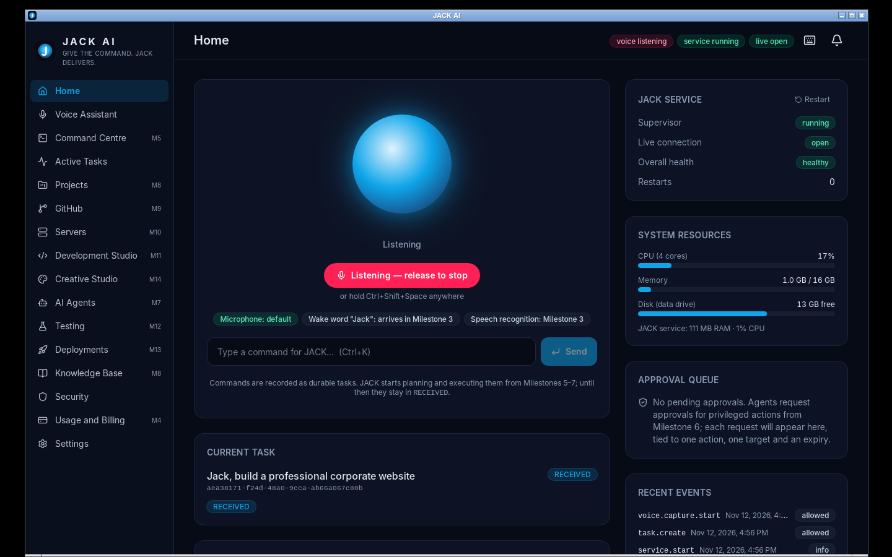
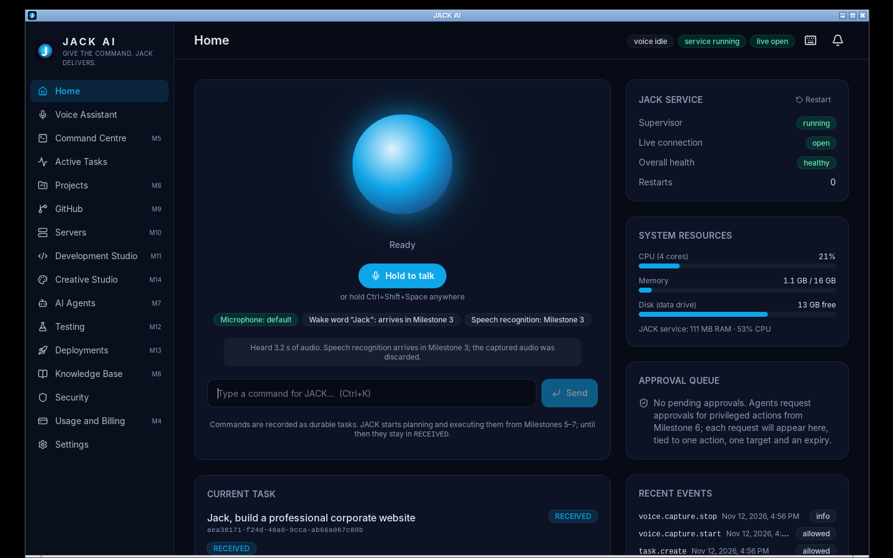
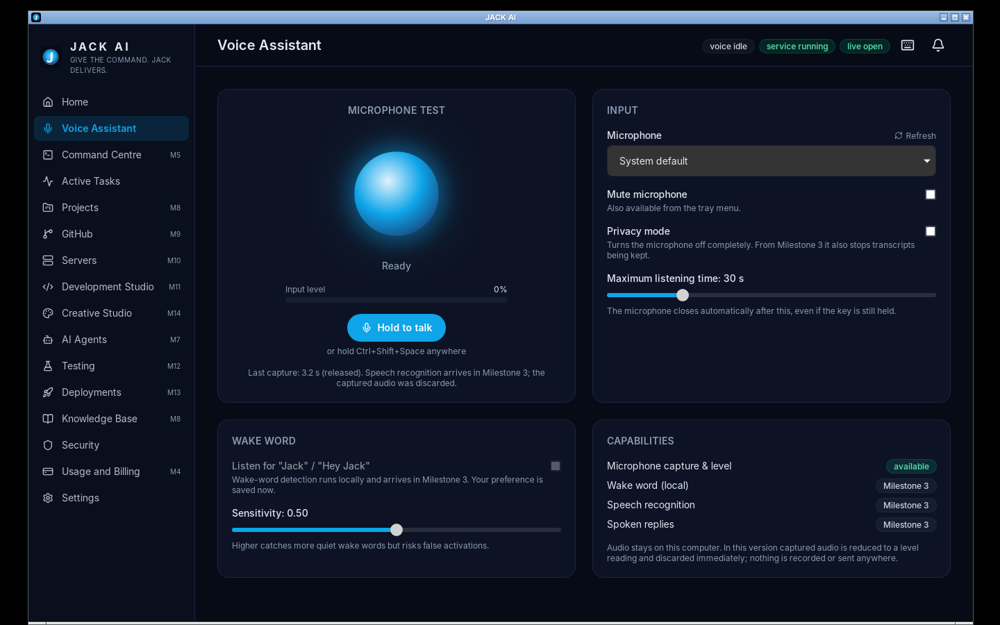
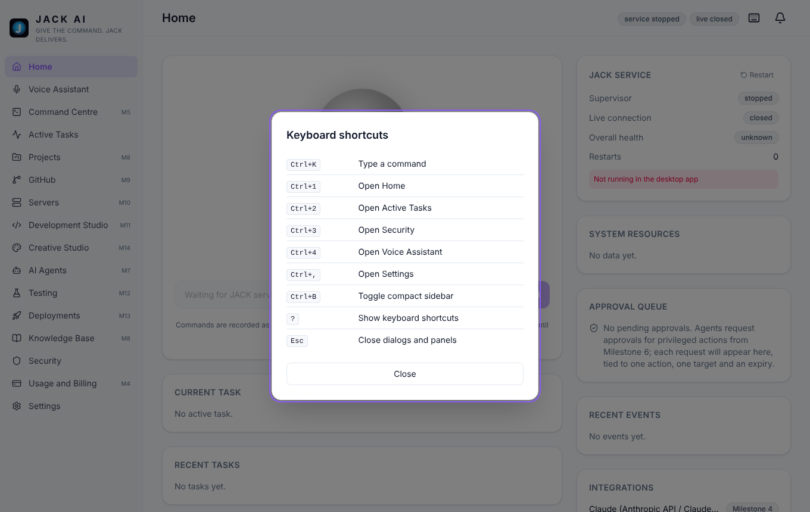

# Milestone 2 Report — Dashboard and Voice Interface

**Branch:** `dev/m2-dashboard-voice` (based on `dev/m1-foundation`) · **Date:** 2026-11-12 · **Version:** 0.1.0 (developer preview)

## 1. Summary

Milestone 2 turns the shell into the Section 21 dashboard and builds the **voice interface**.

Push-to-talk works from an on-screen button and from a global **Ctrl+Shift+Space** hotkey that works while the window is hidden. It opens the selected microphone through PortAudio and drives the orb with the live input level. Mute and privacy mode are enforced by the service, every capture is audited, and a watchdog reports microphones that open but deliver no audio. A notification centre, live system metrics, a tray mute toggle and start-with-Windows complete the scope.

**Deliberately not done (Milestone 3):** wake-word detection, speech recognition and spoken replies. The API reports them as unavailable (`capabilities.wake_word/speech_recognition/speech_synthesis = false`). The UI labels them "Milestone 3". After push-to-talk, JACK says how long it listened and that the audio was discarded. Nothing is transcribed, recorded or sent anywhere.

## 2. Test results (real runs)

| Suite | Result | Evidence |
|---|---|---|
| Service tests, SQLite | **83 passed** (+28 since M1) | [service-sqlite.txt](evidence-m2/service-sqlite.txt) |
| Service tests, PostgreSQL 16 | **83 passed** | [service-postgres.txt](evidence-m2/service-postgres.txt) |
| ruff, mypy `--strict`, pip-audit | clean · no issues · no known vulnerabilities | [service-lint-audit.txt](evidence-m2/service-lint-audit.txt) |
| Frontend (vitest) + `tsc` | **25 passed** (+11) · clean | [frontend-tests.txt](evidence-m2/frontend-tests.txt) |
| Rust unit + supervisor integration | **5 + 1 passed** | [rust-tests.txt](evidence-m2/rust-tests.txt) |
| `cargo fmt`, `clippy -D warnings` | clean | [rust-lint.txt](evidence-m2/rust-lint.txt) |
| `cargo audit` / `pnpm audit --prod` | 0 vulnerabilities (same 5 Linux-only GTK/D-Bus warnings as M1) / none | [rust-audit.txt](evidence-m2/rust-audit.txt), [pnpm-audit.txt](evidence-m2/pnpm-audit.txt) |
| **End-to-end, release build, virtual display + virtual microphone** | **14/14 passed** | [e2e-linux-smoke.txt](evidence-m2/e2e-linux-smoke.txt) |
| GitHub Actions CI (5 jobs incl. Linux e2e and Windows) | **5/5 passed** | [run 43264235081](https://github.com/trinath94/jack-ai/actions/runs/43264235081) |

### What the end-to-end test proves (real binaries, no mocks)

A PulseAudio null sink plays a 440 Hz tone, and its monitor is exposed as the system microphone. `xdotool` then holds **Ctrl+Shift+Space** for 3 seconds on the release build:

1. **Hotkey path works.** The audit log shows `voice.capture.start` with `source=hotkey`. The X11 global grab reached the Rust core, which called the authenticated service, which opened the microphone through PortAudio inside the frozen sidecar.
2. **Release closes the microphone.** `voice.capture.stop` shows `stopped_by=released` after about 3.2 s.
3. **Real audio arrived.** The no-audio watchdog, which closes the microphone after 2 s without data, never fired.
4. **The M1 recovery checks still pass:** crash restart, no orphans, close-to-tray, graceful quit, app SIGKILL, and an intact audit chain.

| Holding the hotkey: header shows "voice listening" | Afterwards: honest result, mic closed |
|---|---|
|  |  |

| Voice Assistant page | Light theme + shortcut help |
|---|---|
|  |  |

## 3. Defects found and fixed during the milestone

| # | Defect | Found by | Fix |
|---|---|---|---|
| 1 | A microphone that opens but delivers no audio left the user with a silent "listening" state | Real PortAudio test (the low-latency ALSA default device gave 0 callbacks) | `latency="high"` streams; a 2 s no-audio watchdog closes the mic, emits `voice.error`, and creates a notification and an audit record |
| 2 | Status pills wrapped next to long labels ("Milestone / 4") | Light-theme screenshot review | Pills never shrink or wrap |
| 3 | Shortcut list followed navigation order (Ctrl+1, Ctrl+4, Ctrl+2…) | Screenshot review | Sorted by key |
| 4 | `xdotool key --window` events are ignored by WebKit (test harness) | e2e | Send keys to the active window |

## 4. Feature status

### Complete (implemented and tested)
- **Section 21 dashboard:**
  - The orb shows idle, listening, processing, speaking, disabled and offline states, and follows the live input level.
  - Microphone and wake-word status, with M3 honestly labelled.
  - Command box (Ctrl+K), current task and timeline, recent tasks.
  - CPU, memory and disk meters plus service memory.
  - Recent events (audit), service and component health.
- **Voice interface:**
  - Microphone list with stable device ids; selection persisted.
  - Mute and privacy mode enforced by the service; muting while listening closes the mic immediately.
  - Maximum listening time (5–120 s) with auto-close.
  - Wake-word preference and sensitivity are saved; detection itself is M3.
- **Push-to-talk:**
  - Hold-to-talk button (pointer or keyboard; releases on window blur).
  - Global **Ctrl+Shift+Space** hold-to-talk handled in Rust, working with the window hidden. If the key combination is taken, an error is shown instead of crashing.
- **Audio capture:** PortAudio via `sounddevice`; samples reduced to a dBFS level in the callback and discarded; level events throttled to 15 Hz; capture start/stop/error audited; no-audio watchdog.
- **Notification centre:** migration 0002; created for task terminal and hold states, component degradation and recovery, and microphone problems; live updates; unread badge; mark read / mark all read.
- **System metrics:** psutil, streamed every 3 s only while a client is connected.
- **Tray:** mute-microphone checkbox (reverts if the service refuses) and a voice-state tooltip.
- **Start with Windows:** autostart plugin; an autostart launch goes straight to the tray.
- **Theming and shortcuts:** light, dark and live system theme; accent colours; compact mode; shortcut help dialog.
- **Voice health component:** degraded when there is no microphone or PortAudio is missing.

### Partially implemented
- **Approval queue:** shown, but empty until approvals exist (M6). No placeholder data.
- **Integrations, API usage and cost, agent activity, GitHub, servers, deployments on the dashboard:** shown as not configured, each with its milestone.

### Not verified yet
- Real Windows microphones (WASAPI/MME) and the global hotkey on Windows. The Windows CI job checks that PortAudio and psutil are bundled into `jack-service.exe`, but CI runners have no microphone and no interactive desktop. **Please try push-to-talk on a Windows machine.**
- The start-with-Windows registry entry has not been verified on Windows, only that the plugin builds and the toggle calls it.
- The tray mute checkbox cannot be clicked under Xvfb, which has no system tray host. Its API path is tested; the click is not.

### Not yet implemented (milestone)
Everything from Milestone 3 onward (`docs/ROADMAP.md`), including the wake word, ASR and TTS (M3).

## 5. CI

[Run 43264235081](https://github.com/trinath94/jack-ai/actions/runs/43264235081), commit `0c9a1fc`: **all 5 jobs passed**.

| Job | Result |
|---|---|
| Python service (SQLite + PostgreSQL 16) | ✅ |
| Frontend (type drift check, tests, build, audit) | ✅ |
| Rust core (fmt, clippy, unit + supervisor integration, cargo-audit) | ✅ |
| **End-to-end on a fresh Ubuntu runner** (release build, Xvfb, virtual PulseAudio mic, global hotkey) | ✅ |
| Windows x64 (service tests, frozen sidecar smoke, Rust incl. Job Object, NSIS + MSI) | ✅ |

**Windows details from the CI log:**
- Service tests: 79 passed, 4 POSIX-only skipped. Rust: 5 + 1 passed.
- Frozen `jack-service.exe` smoke test: `capture_detail: "No microphone found"`. PortAudio is bundled and loads; the runner simply has no microphone. psutil metrics work. Wake word, ASR and TTS are reported unavailable (`pending_milestone: 3`).
- Installers, both **NotSigned**:
  - `JACK-AI-Setup-x64.exe`: 30.7 MB, SHA-256 `0AF3978C…5B295`
  - `JACK-AI-x64.msi`: 31.5 MB, SHA-256 `6EE1B34E…3295E`

## 6. Next milestone

**M3: Wake word and speech processing.** VAD (Silero), local ASR (faster-whisper), Windows SAPI TTS with interruptible playback, and a custom-trained openWakeWord model for "Jack" / "Hey Jack" with a false-activation and missed-detection evaluation report. The custom model needs decision D-3, because the pre-trained openWakeWord models are licensed for non-commercial use only. All of it builds on the capture pipeline delivered here.
