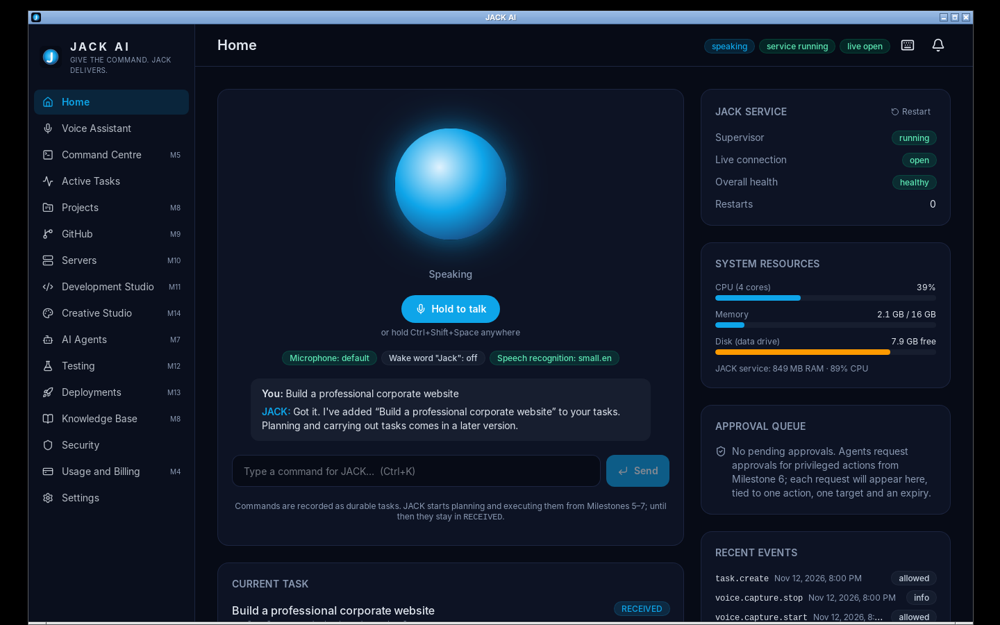
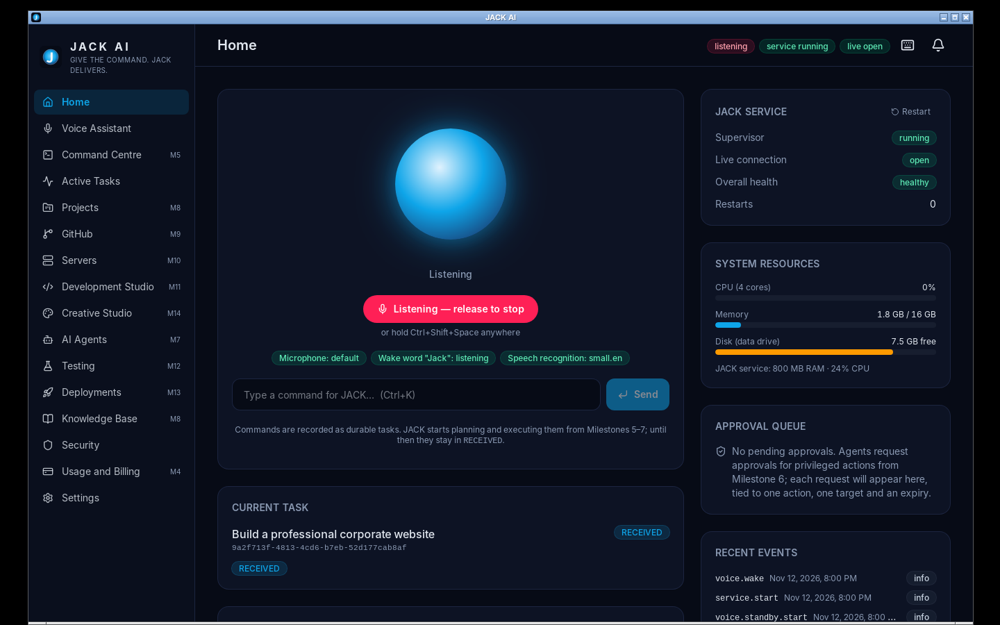

# Milestone 3 Report — Wake Word and Speech Processing

**Branch:** `dev/m3-speech` (from `main` after Milestones 1–2) · **Date:** 2026-11-12 · **Version:** 0.1.0 (developer preview)

## 1. Summary

JACK now understands speech, entirely on the user's computer. There are two ways to talk to it:
- **Push-to-talk:** hold Ctrl+Shift+Space.
- **Wake word:** say **"Jack"**. JACK answers "Yes, I'm listening"; then give the command, or say it all at once: "Jack, open GitHub".

The Section 4 pipeline is implemented end to end:

> microphone → noise filter (80 Hz high-pass) → Silero VAD → wake word → Whisper speech recognition → command → task → spoken reply

Commands become durable voice tasks. JACK replies through Windows voices (SAPI), is interrupted by push-to-talk, and ignores its own voice. Conversation history keeps text only, with retention and opt-out.

Two honest limits:
- JACK records commands but cannot carry them out until Milestones 5–7, and says so in its reply.
- The wake word reached a **12.5% miss rate** on synthetic speech, against a field target of ≤5%. Real-voice testing on Windows (acceptance test A) is still needed.

## 2. Key decision: the wake-word engine (D-3)

The spec recommends an openWakeWord-compatible detector. openWakeWord's **code** is Apache-2.0, but its **pre-trained models are CC BY-NC-SA 4.0 (non-commercial)**, and there is no model for "Jack". Shipping one means training a custom model with commercially licensed data, which is decision D-3.

So that M3 is not blocked, JACK ships **`keyword-asr`**: VAD finds an utterance, and the first 2.5 s are transcribed by Whisper `tiny.en` (MIT) and matched against the wake phrase. It's commercially shippable today. The detector sits behind a `WakeDetector` protocol, so an openWakeWord model can replace it later without touching the engine.

### The evaluation drove the design

The harness is `scripts/eval_wakeword.py`. It feeds 684 synthetic clips through the shipped code path:
- **Positives:** 5 wake phrases × 8 espeak-ng voices × 2 speeds × 3 noise levels.
- **Negatives:** 37 sentences, 13 of them adversarial sound-alikes, × 4 voices × 3 noise levels = 28.5 min of speech.

| Iteration | Miss rate | False activations (everyday / sound-alike) |
|---|---|---|
| 1. tiny.en, plain transcription | 41.7% | 0 / 1 |
| 2. tiny.en biased with "Hey Jack." | 13.3% | 0 / 29 |
| 3. base.en, plain | 60.4% | 0 / 0 |
| 4. base.en, biased | 19.2% | 0 / 17 |
| **Shipped: tiny.en biased + unbiased sound-alike veto** | **12.5%** | **0 / 20** |

The final run was measured with the shipped detector code ([wakeword-eval.md](evidence-m3/wakeword-eval.md)):

| Sensitivity | Miss rate (clean / 20 dB / 10 dB) | False activations on 288 everyday clips | on 156 sound-alike clips |
|---|---|---|---|
| < 0.5 (strict) | 47.1% (33.8 / 37.5 / 70.0%) | 0 | 1 |
| **≥ 0.5 (default 0.5)** | **12.5% (7.5 / 7.5 / 22.5%)** | **0** | 20 ("Hey Jake", "Hey Zack", "Jackson…", "Jacqueline…") |

**Reading these numbers:**
- espeak-ng voices are far more robotic than people. Most misses are Whisper hearing a synthetic "Jack" as "Doc" or "Yeah".
- Ordinary speech **never** woke JACK in either mode.
- The sound-alike set is deliberately adversarial; names that sound like "Jack" are the realistic false-activation risk.

Until real-voice results exist, these figures are a regression baseline, not field performance. If real users miss more than about 5%, the remedy is D-3: a dedicated model trained on real recordings.

## 3. Test results (real runs)

| Suite | Result | Evidence |
|---|---|---|
| Service tests, SQLite | **138 passed** (+55 since M2) | [service-sqlite.txt](evidence-m3/service-sqlite.txt) |
| Service tests, PostgreSQL 16 | **138 passed** | [service-postgres.txt](evidence-m3/service-postgres.txt) |
| **Real-model tests** (Silero VAD + Whisper tiny/small on espeak-ng speech through the engine; espeak-ng TTS playback and interruption) | **8 passed** | [real-speech-tests.txt](evidence-m3/real-speech-tests.txt) |
| ruff, mypy `--strict`, pip-audit | clean · clean · no known vulnerabilities | [service-lint-audit.txt](evidence-m3/service-lint-audit.txt) |
| Frontend (vitest) + `tsc` | **27 passed** · clean | [frontend-tests.txt](evidence-m3/frontend-tests.txt) |
| Rust unit + supervisor integration | **5 + 1 passed**; fmt and clippy clean | [rust-tests.txt](evidence-m3/rust-tests.txt) |
| `cargo audit` / `pnpm audit` | 0 vulnerabilities (same 5 Linux-only GTK warnings) / none | [rust-audit.txt](evidence-m3/rust-audit.txt) |
| **End-to-end, release build, real speech into a virtual microphone** | **20/20 passed** | [e2e-linux-smoke.txt](evidence-m3/e2e-linux-smoke.txt) |
| Wake-word evaluation | see §2 | [wakeword-eval.md](evidence-m3/wakeword-eval.md) |
| GitHub Actions CI | _see §6_ | |

### End-to-end: what was proven on the release build

espeak-ng speech plays into a PulseAudio virtual microphone, and the frozen 172 MB sidecar runs real models:

1. **Push-to-talk.** Holding the global hotkey while "Build a professional corporate website." plays gives a voice task with exactly that text, and history records 2 turns.
2. **Wake word.** The wake-word setting persists across a restart and standby starts.
   - Spoken "Hey Jack." is detected.
   - JACK says "Yes, I'm listening." **into the same virtual microphone**. It doesn't react to itself, which proves half-duplex echo suppression.
   - Spoken "Create a professional company logo." becomes a wake-triggered voice task with exactly that text.
3. **Earlier milestones still hold:** crash restart, no orphans, close-to-tray, graceful and hard quit, and the audit chain.

| Push-to-talk result and JACK's reply | Listening after the wake word |
|---|---|
|  |  |

## 4. Defects found and fixed

| # | Defect | Found by | Fix |
|---|---|---|---|
| 1 | **Push-to-talk clipped the last word** ("…corporate website" → "…car"): the buffer was snapshotted on release while frames were still queued | Real-model test | Drain the queue and capture a 250 ms release tail; regression test added |
| 2 | **espeak-ng claimed success with no audio device** (it exits 0) | TTS test | Detect the device error; the engine raises `voice.error` instead of pretending it spoke |
| 3 | **Wake-word miss rate of 42%** | Evaluation | Biased pass plus sound-alike veto: 12.5% (§2) |
| 4 | The no-audio watchdog (2 s) nearly fired on a slow-starting device (1.9 s to first frame) | e2e log | 4 s; "microphone opened" and "delivering audio" are now logged for diagnosis |
| 5 | After the wake word, the button said "release to stop" even though nothing was held | e2e screenshot | The label follows the button's own pressed state; UI test added |
| 6 | faster-whisper 1.2.1 is incompatible with PyAV 19 | Model benchmark | Pinned `av==18.1.0` |
| 7 | e2e virtual microphone delivered no frames (a suspended null sink; PulseAudio cookie hidden by the `HOME` change) | e2e | Test environment fixed; the product was not at fault, and its new logs pinpointed the cause |

## 5. Feature status

### Complete (implemented and tested with real models)
- **Audio pipeline:** 32 ms frames, worker thread, 80 Hz high-pass filter, streaming Silero VAD v6 (bundled, MIT), utterance segmenter with pre-roll.
- **Speech recognition:** Whisper `small.en` (default), `base.en`, `tiny.en` via CTranslate2 int8 on CPU.
  - Downloaded only on user request, with progress, delete and error/retry; offline afterwards.
  - Models are pre-loaded at start-up.
  - Benchmark (4 CPU cores): `small.en` transcribed a 3.6 s command in 1.16 s.
- **Push-to-talk to task:** transcription, wake-phrase stripping, voice task, spoken confirmation.
- **Wake word "Jack" / "Hey Jack":**
  - Standby listening; the reply, then a command window that times out after 6 s.
  - Inline commands; two-tier sensitivity; audited.
  - Mute, privacy mode, unknown device and a missing model all handled.
- **Spoken replies:**
  - Windows SAPI via COM (voice list, rate); espeak-ng on Linux.
  - Interruptible, with push-to-talk barge-in and a stop button.
  - Half-duplex echo suppression plus a 300 ms guard; failures reported.
- **Conversation history:** migration 0003; text only; retention purge at start-up (30 days default); opt-out; clear (audited); never in privacy mode.
- **Voice UI:**
  - Model management; recognition settings; wake word with sensitivity guidance; replies (voice, speed, test, stop); history.
  - The dashboard shows the last exchange; the header, orb and tray show the standby state.
- **Evaluation harness** with saved per-clip transcripts.

### Partially implemented / not verified
- **Windows audio path:** the SAPI voice listing is tested on the Windows CI runner, but real speech in and out on a Windows desktop (acceptance test A) has not been run. Please try it (§7).
- **Optional cloud speech recognition and premium voices:** not implemented. Both need provider accounts (M4 provider work); the TTS and ASR interfaces are the plug-in points.
- **Wake-word field accuracy:** synthetic only (§2).
- **Multilingual:** English-only models (`*.en`), as the spec allows for now.

### Resource notes
- **Service memory:** about 800–850 MB with `small.en` and `tiny.en` loaded. Choose `base.en` on low-memory PCs.
- **CPU:** standby uses about 1 ms of CPU per 32 ms frame for VAD. Each utterance heard in standby costs one tiny.en transcription (two when the wake phrase matches).
- **Sidecar size:** 172 MB as a one-file executable; start-up about 2.9 s. A one-folder layout would start faster and is planned for M18.

## 6. CI

_Filled in after the run on this branch._

## 7. What you can try on Windows

1. Install the `JACK-AI-Setup-x64.exe` from this branch's CI run.
2. Voice Assistant → Speech models → **Download** `small.en` and `tiny.en`.
3. Hold **Ctrl+Shift+Space** and say "Build a professional corporate website". You should hear JACK confirm, and the task appears.
4. Turn on **Listen for "Jack"** and say "Jack". After "Yes, I'm listening", say a command.
5. Tell me roughly how often "Jack" was missed or JACK woke on its own. That decides whether D-3 (a dedicated wake-word model) is worth doing.

## 8. Next milestone

**M4: Claude provider abstraction.**
- Anthropic API and Claude Code providers; keys in Windows Credential Manager.
- Usage and cost tracking, spending limits, connection test.
- JACK's spoken replies can then come from Claude, but only once the user supplies an API key.
