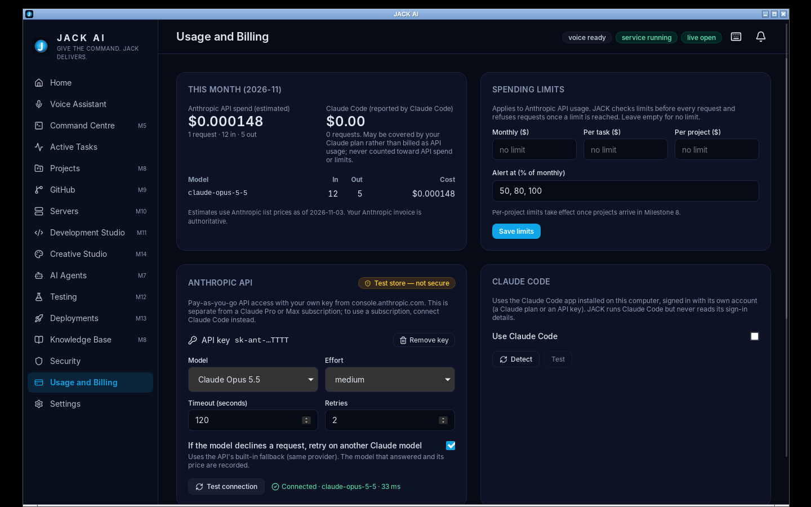

# Milestone 4 Report — Claude Provider Abstraction

**Branch:** `dev/m4-providers` (from `main` after Milestone 3) · **Date:** 2026-11-12 · **Version:** 0.1.0 (developer preview)

## 1. Summary

JACK can now talk to Claude in two ways, behind one provider interface (Section 5):

| | Anthropic API | Claude Code |
|---|---|---|
| What it uses | Your API key from console.anthropic.com, through the official Python SDK (`anthropic` 2.8.0) | Your installed Claude Code CLI, signed in with **its own** account (a Claude plan or an API key) |
| Credentials | Stored in **Windows Credential Manager**; only a hint (`sk-ant-…abcd`) is ever shown | JACK never reads, copies or extracts them; it runs `claude` and reads `claude auth status` |
| Billing | Pay-as-you-go API, estimated per call from a dated price table | Reported by Claude Code; may be covered by a Claude plan; **never counted as API spend** |
| Default role | Reasoning and conversation | Coding work (used from M11) |

Around them:
- **Usage and cost:** tracking per model.
- **Spending limits:** monthly, per task and per project, checked before every call, with alerts.
- **Fallback:** provider fallback that only happens if you turn it on, and is audited when it does.
- **Usage and Billing page:** with a test console.

**Honest limit: no call has succeeded against the real Anthropic API**, because this environment has no API key, and I didn't ask you to paste one into chat. What was verified:

- **Real API, invalid key:** JACK reaches the real `api.anthropic.com` with the stored key and correctly reports the rejection of a deliberately invalid key (§3).
- **Fake API:** a local fake Messages API ran over real HTTP through the official SDK, with exact wire checks, in unit tests and in the release-build e2e.

The first successful real call will be yours: Usage and Billing → paste a key → **Test connection**.

## 2. Decisions

- **Default model `claude-opus-5-5`, effort `medium`** (the model's own default).
  - Server-side **refusal fallback** (`fallbacks: "default"`, beta `server-side-fallback-2026-07-01`) is **on by default** on the models that support it. If Claude declines, the API retries on another Claude model; the response says which model answered, and that model's price is used.
  - You can switch it off on the Usage and Billing page. This stays within one provider, unlike provider fallback, which is opt-in.
- **No plaintext fallback for secrets.**
  - Without Windows Credential Manager (or Keychain or Secret Service), JACK refuses to store a key.
  - Tests and CI use an explicit in-memory store (`JACK_INSECURE_TEST_CREDENTIALS=1`), which the UI labels "Test store — not secure".
- **JACK's key is always passed explicitly** to the SDK, so it can't silently use `ANTHROPIC_API_KEY` or a CLI login profile you never gave JACK.
- **Claude Code isolation:**
  - The prompt goes on stdin, not the command line.
  - JACK's session token and test flags are removed from the child's environment.
  - It runs in an empty temp folder, with one turn and a budget cap from the task limit.
- **Prices are dated (2026-11-03) and never guessed.** Unknown models are recorded with no cost and marked "no price data".
- **Settings stored as typed JSON:** provider settings and limits are stored as typed JSON rather than separate tables (documented in DATABASE.md); tables come with multi-user support in M6.

## 3. Test results (real runs)

| Suite | Result | Evidence |
|---|---|---|
| Service tests, SQLite | **163 passed**, 6 skipped (+25 since M3) | [service-sqlite.txt](evidence-m4/service-sqlite.txt) |
| Service tests, PostgreSQL 16 | **163 passed** | [service-postgres.txt](evidence-m4/service-postgres.txt) |
| ruff, mypy `--strict`, pip-audit (includes `anthropic`, `keyring`) | clean · clean · no known vulnerabilities | [service-lint-audit.txt](evidence-m4/service-lint-audit.txt) |
| Frontend + `tsc` | **35 passed** · clean | [frontend-tests.txt](evidence-m4/frontend-tests.txt) |
| Rust | 5 + 1 passed; fmt, clippy clean | [rust-tests.txt](evidence-m4/rust-tests.txt) |
| `pnpm audit --prod` | no known vulnerabilities | [pnpm-audit.txt](evidence-m4/pnpm-audit.txt) |
| **Real `api.anthropic.com`, frozen sidecar, deliberately invalid key** | messages → `auth` "The Anthropic API key was rejected"; models → `ai_auth`; key in log: 0 | [real-api-auth-check.txt](evidence-m4/real-api-auth-check.txt) |
| **End-to-end, release build (M1 + voice + AI)** | **25/25 passed** | [e2e-linux-smoke.txt](evidence-m4/e2e-linux-smoke.txt) |
| GitHub Actions CI | **5/5 jobs green** (§6) | [run 43306633583](https://github.com/trinath94/jack-ai/actions/runs/43306633583) |

### What the AI tests prove (24 service tests and 5 e2e checks)

1. **The key is stored, never returned:**
   - The status, audit and notification APIs don't contain it.
   - Logs redact it.
   - On the release build, the key typed into the UI is absent from the SQLite database, its WAL file, the app log and the service log.
2. **Correct requests:**
   - The key is sent as `Authorization: Bearer …` (API version `2026-10-21`).
   - Effort is set in `output_config`.
   - Refusal fallback is sent only on models that support it, and effort is never sent to `claude-haiku-4-5`.
3. **Exact costs:**
   - A connection test of 12 input and 5 output tokens on Opus 5.5 costs $0.000148.
   - A refusal-fallback response is priced per model from `usage.iterations` (Opus 5.5 part + Opus 4.8 part = $0.002350).
   - The 1.25× and 2× cache-write rates and Haiku 5.5's long-prompt tier are covered.
4. **Errors:** 401, 429, 500 and refusals are mapped to stable codes and recorded as failures.
5. **Limits:**
   - With a $10 monthly limit and $4 calls: an alert at 80%, then 100%, then the 4th call is refused before reaching the API (402, audited, notified).
   - Per-task limits apply to their own task only.
6. **Claude Code (fake CLI):**
   - Detection reports version and sign-in method.
   - The prompt goes via stdin, with no session-token leak, an empty working folder and one turn.
   - Its reported cost is recorded separately; API spend stays $0.
7. **Provider fallback:** off means an error is returned; on means the call switches to Claude Code, and the switch is audited and announced.
8. **Settings:** validated and persisted. The test-only API base URL is accepted for loopback addresses only.

| Key saved: only a hint is shown, "Test store — not secure" on Linux CI | After Test connection: live cost, usage by model |
|---|---|
|  |  |

## 4. Defects found and fixed

| # | Defect | Found by | Fix |
|---|---|---|---|
| 1 | My fake API expected `x-api-key`; SDK 2.8 sends the key as a Bearer token | First test run (every call 401) | The fake accepts both, and the test asserts the Bearer header JACK actually sends |
| 2 | One-request costs displayed as `$0.0001` instead of `$0.000148` | e2e screenshot | Up to 6 decimal places below one cent; formatter tests |
| 3 | "1 requests" | e2e screenshot | Pluralisation |
| 4 | `keyring` finds Windows Credential Manager through package metadata, which PyInstaller drops | Packaging review | `--copy-metadata keyring` plus backend submodules; the Windows CI smoke step checks the frozen service reports a secure Windows store |
| 5 | The e2e clicked "Test connection" by screen position, which missed on GitHub's runner (different layout); the test was never pressed | First CI run of this branch (e2e 22/25) | Saving a key now moves keyboard focus to **Test connection** (also better for keyboard users; UI test asserts it) and the e2e presses Space instead of clicking a coordinate |

## 5. Feature status

### Complete
- Provider interface, Anthropic API provider, Claude Code provider.
- Credential storage in Windows Credential Manager, with audited set and delete, a hint only, and redaction.
- Model discovery (with "no price data" marking), effort, timeout and retry settings, connection tests, an `ai` health component.
- Refusal fallback within the API; opt-in provider fallback, audited and announced.
- Usage records per model (migration 0004): tokens, estimated or reported cost, failures, latency, request id.
- Monthly summaries by billing kind, model and day.
- Spending limits (monthly, task, project) checked before each call; alert thresholds.
- Usage and Billing page, test console, dashboard integration.

### Not verified yet
- **A successful call to the real Anthropic API**, which needs your key.
- **Windows Credential Manager** with the installed app on your PC. The Windows CI round-trip test and the sidecar check run on GitHub's Windows runner (§6).
- **Real Claude Code** runs. Tests use a fake CLI, because the only real one here is signed in as this session, and JACK must not borrow someone else's login.

### Not implemented (and why)
- **Per-project limits** are stored, but take effect once projects exist (M8).
- **Image and speech provider usage:** speech is local and free, and image providers arrive in M14.
- **Additional AI providers:** the interface is ready; Section 25 integrations come later.
- **Claude doesn't yet handle your voice or typed commands.** That's requirement discovery (M5), the next milestone.

## 6. CI

[Run 43306633583](https://github.com/trinath94/jack-ai/actions/runs/43306633583) on commit `8bc2539`: **all 5 jobs passed.**

| Job | Result |
|---|---|
| Python service (SQLite + PostgreSQL, ruff, mypy, pip-audit, real-model speech 7 passed) | ✅ |
| Frontend (type drift check, `tsc`, 35 tests, build) | ✅ |
| Rust core (fmt, clippy, tests incl. supervisor integration) | ✅ |
| End-to-end, Linux release build (virtual display + microphone + fake Anthropic API) | ✅ **25/25 PASS** |
| Windows x64 (service tests incl. the Credential Manager round trip, frozen sidecar smoke, NSIS + MSI) | ✅ frozen `jack-service.exe` reports `Credential store: keyring.backends.Windows.WinVaultKeyring secure=True` |

The first run of this branch ([43304157506](https://github.com/trinath94/jack-ai/actions/runs/43304157506)) failed the e2e at 22/25; that was defect 5 in §4, fixed in `8bc2539`. The installers are unsigned (no signing certificate configured).

## 7. How to finish verification on Windows

1. Install the build from this branch's CI run and open **Usage and Billing** (Ctrl+5). The key-store badge should read **Windows Credential Manager**.
2. Paste your API key from console.anthropic.com, press **Save key**, then **Test connection**. It should show "Connected · claude-opus-5-5".
3. Ask something in the **Test console**. The answer, tokens and cost should appear, and the month total should update.
4. Optional: open Windows **Credential Manager → Windows Credentials** and you'll see an entry for **JACK AI**.
5. If you use Claude Code, press **Detect**. It should show your version and sign-in method.
