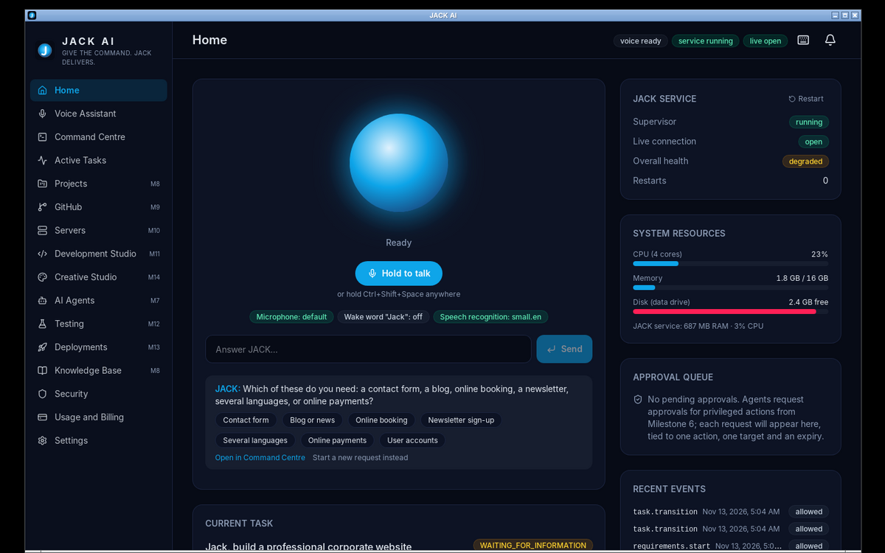
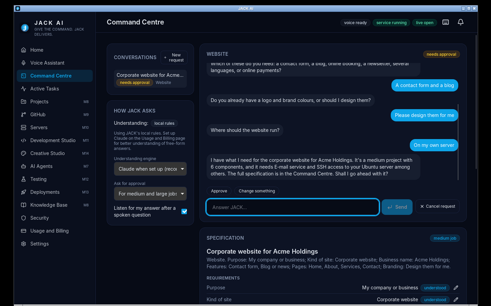
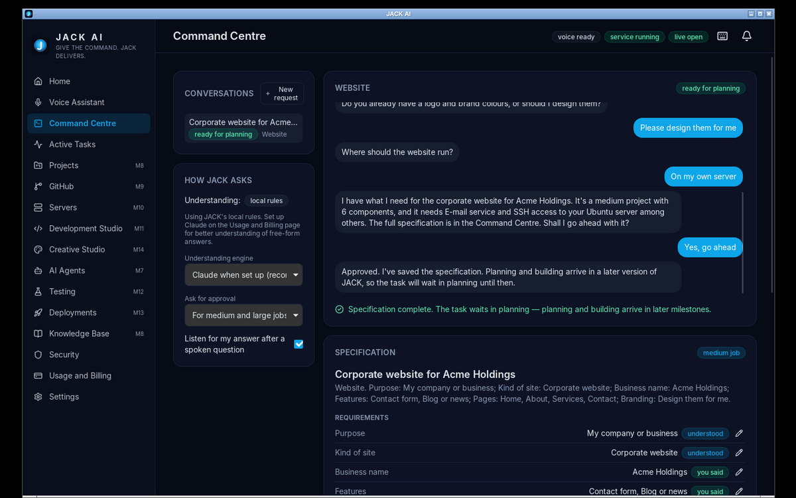

# Milestone 5 Report — Requirement Discovery

**Branch:** `dev/m5-discovery` (from `main` after Milestone 4) · **Date:** 2026-11-13 · **Version:** 0.1.0 (developer preview)

## 1. Summary

When you give JACK a command, by voice or typed, it now does three things before any work starts:
1. It works out which of the 19 kinds of job it is (Section 6).
2. It asks only the questions it needs, one at a time.
3. It writes a structured specification.

The spec's example dialogue runs word for word:

> **You:** Jack, build a professional website.
> **JACK:** Certainly. I'll handle the development of the website. Let me understand your requirements first. What is the website for?
> **You:** My company.
> **JACK:** Would you like a corporate website, a customer portal or a full business platform?
> … → *"I have what I need for the corporate website for Acme Holdings. It's a medium project with 6 components … Shall I go ahead with it?"*

What the engine does (Section 6 checklist):

| Requirement | How |
|---|---|
| Identify the category | Claude (structured JSON) when set up, otherwise local keyword rules. If unclear, it asks "What kind of job is this: …?" |
| Ask only necessary questions | Each category has 2–6 *essential* questions. Everything else takes a default and is listed as an assumption you can change |
| Remember previous answers | Stored per conversation and never asked again. Facts in the opening request count ("…corporate website with online booking" skips three questions) |
| Offer sensible defaults | Every question has one. Say "you decide", or "use defaults" for all remaining questions |
| Identify missing requirements | Unanswered essentials are asked. Text questions skipped with "use defaults" appear as *Still to decide* |
| Detect conflicting requirements | 13 declared conflict rules across 10 categories, plus contradictions Claude notices. Each becomes a question |
| Structured specification | Requirements, assumptions, open questions, notes, which engine understood each answer |
| Scope and dependencies | Components, size (small, medium or large), and what JACK still needs to build it, with the milestone that delivers it |
| External integrations | Implied by answers: payment provider, e-mail service, SSH access, DNS, SSO and so on, each with the reason |
| Hosting | Your Ubuntu server, managed hosting, this PC only, or decide later |
| Approval for large projects only | Medium and large jobs wait for approval. Small jobs (research, a single image, a README) go straight to planning |

Voice works end to end. After JACK asks a question it keeps listening for 8 seconds, so you can answer without saying "Jack" again. It never does this when muted or in privacy mode, and you can turn it off.

**Honest limits:**
- **No real Claude call yet.** Discovery has not been run against the real Claude API, because there's no key in this environment. The Claude path is tested over real HTTP against a local fake Messages API with scripted, schema-shaped replies. The local rules work without Claude and were used in the release-build end-to-end test.
- **Spec only, no work.** After approval the task waits in **Planning**. Planning and carrying out the work start in Milestone 6, and JACK says so in its reply.

## 2. Decisions

- **Catalogue as data.** The 19 categories are declarative templates: 96 questions with options, defaults, conditions, conflicts, implied components and integrations. Behaviour is the same with Claude or local rules, the questions are reviewable, and nothing about the flow depends on a model's wording.
- **Claude's output is checked, never trusted.**
  - Claude only reads the user's words and returns JSON constrained by a schema: `output_config.format` on the API, `--json-schema` on Claude Code.
  - Every value is validated against the catalogue. Unknown categories, slots or options are dropped.
  - Discovery has no tools, so model output can fill in a specification but cannot cause an action (threat T26).
- **Failure never blocks the conversation.** Budget, network, server errors and malformed JSON all fall back to local rules for that turn. The specification notes it, and the failed call is still recorded in usage.
- **Local rules are conservative.**
  - Unasked questions are filled only from the *opening* request; filling them from answers caused wrong fills in testing (§4).
  - Choice questions get one retry with the options read out. After that the default is used and noted.
- **Task states:** UNDERSTANDING → REQUIREMENTS ⇄ WAITING_FOR_INFORMATION → PLANNING. Medium and large jobs pass through WAITING_FOR_APPROVAL. Every transition is validated and audited.
- **Security audits** stop and are cancelled (audited as *denied*) if you say you don't own the targets or have permission to test them.
- **Storage:** one `requirement_sessions` row per task (answers, progress and spec as JSON) plus `requirement_turns`. This replaces the separate `conversations` / `requirement_specs` tables sketched in DATABASE.md; a versioned spec table can follow with projects in M8.

## 3. Test results (real runs)

| Suite | Result | Evidence |
|---|---|---|
| Service tests, SQLite | **237 passed**, 7 skipped (+74 since M4) | [service-sqlite.txt](evidence-m5/service-sqlite.txt) |
| Service tests, PostgreSQL 16 | **237 passed**, 7 skipped | [service-postgres.txt](evidence-m5/service-postgres.txt) |
| ruff, mypy `--strict`, pip-audit | clean · clean · no known vulnerabilities | [service-lint-audit.txt](evidence-m5/service-lint-audit.txt) |
| Frontend + `tsc` | **39 passed** (+4) · clean | [frontend-tests.txt](evidence-m5/frontend-tests.txt) |
| Rust | 5 + 1 passed; fmt, clippy clean | [rust-tests.txt](evidence-m5/rust-tests.txt), [rust-lint.txt](evidence-m5/rust-lint.txt) |
| `pnpm audit --prod` | no known vulnerabilities | [pnpm-audit.txt](evidence-m5/pnpm-audit.txt) |
| **End-to-end, release build (M1 + voice + AI + discovery)** | **31/31 passed** | [e2e-linux-smoke.txt](evidence-m5/e2e-linux-smoke.txt) |
| GitHub Actions CI | _see §6_ | |

### What the discovery tests prove (74 new service tests, 4 UI tests, 6 e2e checks)

1. **The spec's dialogue:**
   - The questions come in the spec's order and wording.
   - Each essential question is asked exactly once; seven replies are all distinct.
   - The spec holds the exact answers and labelled assumptions.
   - The task title becomes "Corporate website for Acme Holdings".
   - Timeline: `RECEIVED, UNDERSTANDING, REQUIREMENTS, WAITING_FOR_INFORMATION, REQUIREMENTS, WAITING_FOR_APPROVAL, REQUIREMENTS, PLANNING`.
2. **Facts in the opening request** aren't asked again. A small research job skips approval, and "Approve every job" makes it ask.
3. **Control phrases:** "you decide", "use defaults", "cancel", and changing an answer at review time ("No, we need single sign-on with Microsoft").
4. **Retries:** an unclear answer gets one retry with the options read out, then the default, noted in the spec.
5. **Conflicts:**
   - Payments on a site that runs only on this PC: "put it online" moves hosting to your server and keeps payments.
   - An admin dashboard without sign-in: "the first one" drops the dashboard.
6. **Edge cases:**
   - An unclear request ("Build an app") asks for the category.
   - A non-work request can be cancelled.
   - A security audit without authorisation is blocked.
   - Invalid edits from the UI are rejected with 400.
7. **Persistence and routing:**
   - Conversations survive a service restart.
   - Voice answers go to the waiting conversation, but a clear new command ("Jack, create a logo…") starts a new one.
8. **Voice:** a spoken command is answered with a spoken question. The answer, spoken during the follow-up window, goes to the same conversation. There is no follow-up in privacy mode.
9. **Claude, over HTTP to the fake API:**
   - Requests carry the JSON schema, effort `low` and the JACK system prompt.
   - An invented slot and an invalid option are dropped.
   - Free-form answers fill several slots at once.
   - Claude-noticed contradictions are asked once and recorded.
   - Usage is recorded against the task as `discovery.classify` / `discovery.extract`.
   - Server errors, invalid JSON and a $0 monthly limit fall back to local rules without stopping the conversation.
   - *Local rules only* sends nothing to Claude.
10. **Catalogue integrity:**
    - All 19 categories in the spec's order.
    - Every default, condition and conflict fix refers to a real option.
    - Every category is reachable by name.
    - The local classifier gets one test command per category right (19/19).
    - "You decide" phrases never select an option.
11. **Release build (e2e):**
    - A typed conversation through the Home box, through to approval: one question at a time, nothing asked twice, task in PLANNING, hosting recorded.
    - With real speech recognition, a spoken command plus a spoken answer captured by follow-up listening, without the wake word.

| JACK's question on Home, with answer chips | Specification awaiting approval | Approved |
|---|---|---|
|  |  |  |

## 4. Defects found and fixed

| # | Defect | Found by | Fix |
|---|---|---|---|
| 1 | Local rules inferred "corporate site" from the word *website* and a "classic" style from *professional*, so the spec's own question was skipped | First scripted run | Removed generic keywords from those options |
| 2 | Answering "a contact form" also set *Pages: Contact* | First scripted run | Local rules fill unasked questions only from the opening request |
| 3 | A held task can't go from *waiting for information* straight to *waiting for approval* | Design review of the state machine | Every move leaves a hold state first, so the timeline stays valid |
| 4 | Malformed Claude JSON (`"values": 5`) raised an error instead of falling back | New test | Schema shape checked; falls back to local rules |
| 5 | "Remove the background from these product photos" was not classified | Classifier test | Added the plural and phrase keywords |
| 6 | Navigating away from Home and back lost the conversation, so "Yes, go ahead" started a new request | Release-build e2e (30/31) | The Home box restores the conversation JACK is waiting on; UI test added |
| 7 | JACK referred to a "Requirements page" that's called the Command Centre | e2e screenshot | Wording |
| 8 | A spoken new command during an open conversation would be taken as an answer | Review while writing the e2e | New-command detection (command verb + confidently recognised category); tests |
| 9 | Spoken name answers kept lead-ins ("The business is called …") | ASR measurement (below) | Broader lead-in stripping; tests |

**Speech recognition and names.** In one e2e run, small.en heard the synthetic voice's *"It's called Acme Holdings"* as *"callback me holdings"*. I measured three speaking speeds:

| Phrase | Correct |
|---|---|
| "It's called Acme Holdings." | 1/3 |
| "It's called Green Valley Bakery." | 3/3 |
| "The business is called Blue Harbor Consulting." | 3/3 |
| "Northwind Traders." | 3/3 |

Unusual names can be misheard, so the spec lists every answer and each one can be corrected in the Command Centre. The e2e uses a reliably recognised name.

## 5. Feature status

### Complete
- The 19-category catalogue.
- Classification (Claude or local rules).
- One-question loop with memory, defaults, retries, control phrases and conflict handling.
- Structured specification with scope, integrations, hosting, dependencies and assumptions.
- Approval for medium and large jobs.
- Security-audit authorisation check.
- Task-state integration with audit events.
- Voice integration with follow-up listening.
- Command Centre (Ctrl+6) with an editable specification and settings, and a conversational Home box.
- The task-scoped routes drafted before M5 (`/v1/tasks/{id}/answers`, `/spec`, `/spec/approve`).

### Not verified yet
- **Discovery with real Claude**, which needs your Anthropic key or Claude Code. Claude Code's `--json-schema` output field (`structured_output`) follows the CLI's documented flag but hasn't been run here, because the only Claude Code in this environment is signed in as this session.
- **Spoken conversations on your PC** with Windows SAPI voices and a real microphone (CI covers SAPI playback separately).

### Not implemented (and why)
- **Planning and execution** after approval: Milestone 6 onward. The task waits in Planning.
- **Discovery in other languages:** English only, as with speech recognition.
- **Spec versions and history:** edits update the spec in place and are audited (`requirements.edit` / `requirements.revise`). Versioned specs come with projects in M8.
- **Picking up an existing project's details:** projects arrive in M8, so every conversation starts fresh.

## 6. CI

_Filled in after the run on this branch._

## 7. How to try it on Windows

1. Install the build from this branch's CI run. Download `small.en` and `tiny.en` on the Voice page if you haven't already.
2. Hold **Ctrl+Shift+Space** and say *"Build a professional website."* JACK answers *"…What is the website for?"* Release the keys and just answer; no wake word is needed during the follow-up.
3. Keep answering, or say *"use defaults"*. Open **Command Centre** (Ctrl+6) to see the specification, change any answer, and **Approve**.
4. Optional: set up Claude in Usage and Billing, then try free-form answers ("we sell furniture and customers should log in to see orders"). The Command Centre shows *Understanding: Claude*.
