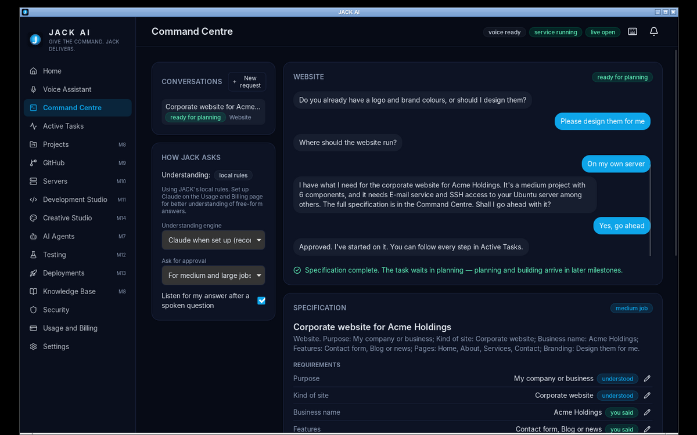
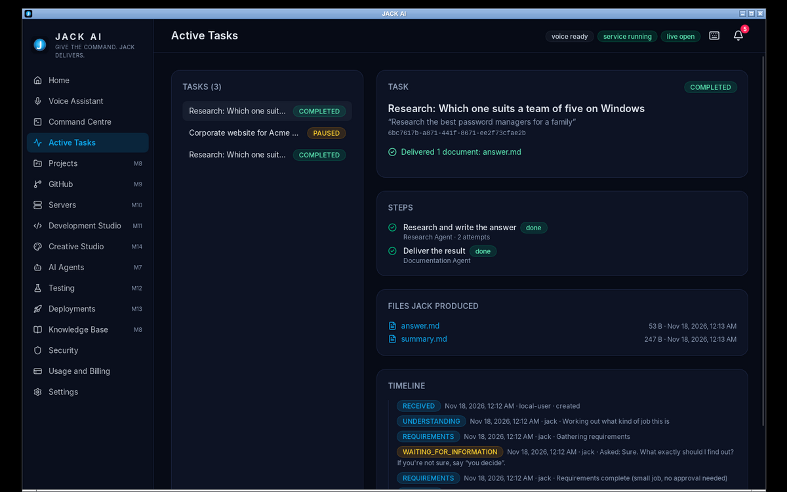
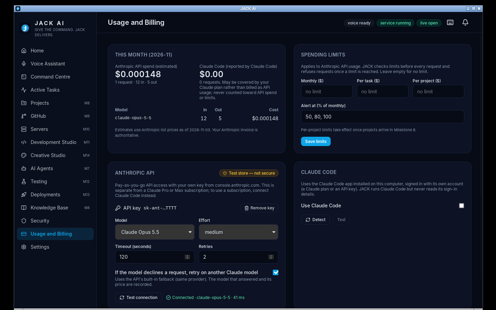

# Milestone 6 Report — Durable Task Orchestration

**Branch:** `dev/m6-orchestration` (from `main` after Milestone 5) · **Dates:** 2026-11-13 → 2026-11-17 · **Version:** 0.1.0 (developer preview)

## 1. Summary

Tasks now *run*, and they survive crashes, restarts and power loss.

- **Embedded PostgreSQL 16** (decision **D-1**, approved 2026-11-13):
  - JACK runs its own database on `127.0.0.1`, with a password kept in Windows Credential Manager.
  - Preferences stay in SQLite (`prefs.db`).
  - An existing SQLite database is moved across once, verified, and kept as a backup.
  - If PostgreSQL can't run, JACK uses SQLite and says why.
- **Temporal** runs as a sidecar. Every task leaving requirement discovery gets a durable workflow: *plan → approvals → steps → done*. Temporal keeps the history, so after a crash the workflow continues where it was.
- **Each task has a plan of steps.** Each step has an owner role (from Section 7's 17 agents) and is marked as safe or unsafe to repeat.
- **What JACK can do itself in M6:** Claude writes real documents, saved as files you can open in the task:
  - research answers
  - documentation
  - solution architectures
  - creative briefs
  - diagnostic and audit plans
- **Later capabilities:** steps that need them (building M11, testing M12, deployment M13, servers M10, image providers M14, Windows automation M15) pause there and name the milestone.
- **Controls:** pause, resume, cancel (applied at a safe point), and retry from the first unfinished step.
- **Approvals:**
  - Each is bound to one action, one target, a scope and an expiry, with a single-use nonce.
  - Each is verified in JACK's own database, so a forged signal to Temporal's unauthenticated local port approves nothing.
  - The discovery spec approval from M5 is now one of them.
- **Recovery (Tests H and J):**
  - Steps that are safe to repeat are repeated; others wait for your review.
  - A task whose history is lost is flagged, not guessed.
  - A missing or rejected key, or a spending limit, *pauses* the task, which carries on by itself once fixed.

A walk through the release build (end-to-end test on embedded PostgreSQL, 26/26):

> Approve the website spec → *"Approved. I've started on it."* → the task waits: *"Needs Claude: set up the Anthropic API…"* → enter a key → it continues by itself and writes `architecture.md` → it stops honestly: *"Waiting at 'Create the project structure': Needs autonomous development with Claude Code, which arrives in Milestone 11"*.
> A research task's service is SIGKILLed mid-step → JACK restarts, recovers it, repeats the step, writes `answer.md`.
> Everything (app, service, PostgreSQL, Temporal) is killed with -9 mid-step → JACK starts again and finishes the task.

**Honest limits:**
- No real Claude call has run here, because there's no key in this environment. Steps ran against the local fake Messages API.
- A real Windows reboot hasn't been tried. Power loss was simulated on Linux by killing every process with -9; the Windows build and its tests run in CI (§6).
- Planning uses fixed templates per category; Claude-written plans arrive with the Chief Orchestrator in M7.

## 2. Decisions

- **D-1: embedded PostgreSQL**, as specified in Section 2.
  - **Binaries:** from the `pixeltable-pgserver` 0.7.2 wheel: PostgreSQL 16.15 plus pgvector 0.8.7, used as plain files. The wheel's PostgreSQL 18 copy isn't shipped.
  - **Access:** loopback only, with SCRAM passwords and no `trust` rules.
  - **Start-up on Windows:** started through `pg_ctl`, because PostgreSQL refuses administrator rights. JACK grants its own user SID on the data folders, so this also works when JACK runs elevated (CI found this; §4).
  - **Start-up on Linux:** a direct child with a parent-death signal, so it can never be orphaned.
- **Temporal CLI 1.9.1 (Server 1.32.0), built from source.** The release binaries aren't on a package registry this environment can reach.
  - `scripts/build_temporal.py` fetches the pinned release through the Go module proxy.
  - Both source modules are checked against pinned hashes and Go's checksum database.
  - The build is reproducible: root and normal-user builds gave the same SHA-256 (`1f6b52c8…`).
  - It ships as a second Tauri sidecar.
- **The workflow only orders things; activities do the work.**
  - Every effect (steps, approvals, files, audit, task states) is an activity writing JACK's database.
  - A replay can't repeat or lose a recorded effect.
- **Plans are templates for now.** They're deterministic, reviewable and free; the M7 orchestrator will refine them with Claude.
- **Spec approval is the execution approval.** A medium or large job gets a single approval (Section 6: approve the spec before execution), not a second plan approval. Step approvals (e.g. *Deploy to production*) use the same mechanism when those steps become runnable.
- **User-fixable problems pause, they don't fail.** A missing or rejected key, missing permission or a spending limit is a pause with the reason. Transient errors (rate limits, outages, timeouts) are retried, then fail with retry available.

## 3. Test results (real runs)

| Suite | Result | Evidence |
|---|---|---|
| Service tests, as root (embedded-PostgreSQL tests skip: PostgreSQL refuses root) | **253 passed**, 13 skipped | [service-sqlite-root.txt](evidence-m6/service-sqlite-root.txt) |
| Service tests, as a normal user (embedded PostgreSQL and Temporal included) | **259 passed**, 7 skipped (+22 since M5) | [service-sqlite-nonroot.txt](evidence-m6/service-sqlite-nonroot.txt) |
| ruff, mypy `--strict`, pip-audit (incl. `temporalio`, `pixeltable-pgserver`, `psycopg`) | clean · clean · no known vulnerabilities | [service-lint-audit.txt](evidence-m6/service-lint-audit.txt) |
| Frontend + `tsc` | **43 passed** (+4) · clean | [frontend-tests.txt](evidence-m6/frontend-tests.txt) |
| `pnpm audit --prod` | no known vulnerabilities | [pnpm-audit.txt](evidence-m6/pnpm-audit.txt) |
| **End-to-end, release build, embedded PostgreSQL** (normal user, voice off) | **26/26 passed** | [e2e-linux-postgres.txt](evidence-m6/e2e-linux-postgres.txt) |
| **End-to-end, release build, voice on** (as root, so the SQLite fallback) | **37/37 passed** | [e2e-linux-root-voice.txt](evidence-m6/e2e-linux-root-voice.txt) |
| GitHub Actions CI (incl. Windows) | **5/5 jobs green** (§6) | [run 44286967450](https://github.com/trinath94/jack-ai/actions/runs/44286967450) |

### What the new tests prove

**Embedded PostgreSQL:** 6 tests with the real binaries.
- Start, stop and restart, with the password only in the credential store.
- Loopback-only listening, no `trust` rules, wrong passwords rejected.
- A server left by a crash is stopped before a new start.
- A missing password is reported, not guessed.
- The whole app runs on PostgreSQL.
- An M5 SQLite database moves across once: rows and conversations intact, audit chain verified, preferences in `prefs.db`, backup kept, never moved twice.
- With no binaries, JACK falls back to SQLite, health is *degraded*, and a notification gives the reason.

**Orchestration:** 15 tests on a real Temporal server.
- **Research end to end:** completed, real `answer.md` and `summary.md`, specification in the prompt, usage billed to the task, full audit.
- **Website:**
  - The approval is decided by voice.
  - `architecture.md` is written, then the task stops at `structure` ("Milestone 11").
  - Resuming re-checks and pauses again, with 0 attempts: nothing pretends to build.
- **No Claude:** the task waits, then continues as soon as a key is saved, without a restart.
- **Rejected key:** the task pauses with that reason, doesn't spin or burn retries, and continues once a valid key is saved.
- **Pause and cancel:**
  - Pause lets the running step finish, then waits; resume continues.
  - Cancel stops a running step, records the reason, and closes the run.
- **Retry:** a step failing 3 times fails the task. Retry continues from that step, and the finished outline is not redone (still 1 attempt).
- **Approvals:**
  - Bound to action, target, scope and risk.
  - A forged Temporal signal approves nothing.
  - A wrong nonce gets 409, and a second decision gets 409 (single use).
  - Denied means cancelled; an expired approval pauses the task, and resume asks again.
- **Restarts:**
  - A running safe step is repeated after a restart (≥ 2 attempts, recovery notification).
  - An *unsafe* step interrupted by a restart becomes `needs_review`; resuming runs it again.
  - Tasks waiting in planning start when orchestration comes back.
  - Lost workflow history is flagged ("couldn't find this task's progress").

**Release build (e2e):**
- **On PostgreSQL:**
  - The spec approval is a bound record decided in the UI.
  - The task waits for Claude, then continues by itself once the key is saved.
  - It survives a service SIGKILL mid-step (step repeated, recovery audited) and a simulated power loss.
  - It leaves no PostgreSQL or Temporal process after quitting or after the app is SIGKILLed.
  - The API key appears nowhere in the PostgreSQL cluster files, `prefs.db` or the logs.
  - The audit chain stays linked across all restarts (79 events).
- **As root with voice:** everything from M3–M5 still passes, plus the same crash and power-loss checks on the SQLite fallback.

| Spec approved: the task has started | After a power loss: completed, step repeated | Usage and Billing on PostgreSQL |
|---|---|---|
|  |  |  |

## 4. Defects found and fixed

| # | Defect | Found by | Fix |
|---|---|---|---|
| 1 | **Each crash leaked ≈560 MB.** The frozen service unpacks itself to a temp folder on every start, and a killed process never removes it: 42 such folders had piled up during testing | Disk filled during the crash e2e | At start-up JACK removes earlier copies of its own bundle. It never touches the running one or one a live process executes from, and does so in the background. Tests added |
| 2 | **A step that lost its Claude access FAILED** after burning its retries, instead of waiting for the user | Crash e2e (the test key store is memory-only) | Missing or rejected key, missing permission and spending limits now pause the step with the reason. It continues by itself once fixed. A run-time block waits for resume or a setup change, so it can't spin |
| 3 | **The Home box could jump back to an older conversation** when the live update arrived before the HTTP reply, sending the next answers to the wrong conversation | Power-loss e2e | The box tracks its current conversation in a ref. A late refresh can't override a newer one; regression test fails on the old code |
| 4 | **A typed new request in an open conversation was taken as an answer** | Same e2e | Typed messages get the same rule as voice since M5: a clear new request (command verb plus recognisable job) starts a new conversation |
| 5 | **PostgreSQL couldn't start when JACK runs as Administrator on Windows.** `initdb` drops admin rights and couldn't read files owned via the Administrators group | First CI run on Windows | JACK grants its own user SID full control of its data and log folders |
| 6 | **Tasks created directly couldn't be planned** (RECEIVED can't jump to PLANNING) | Orchestration tests | Planning goes through UNDERSTANDING for those |
| 7 | **Approval expiry crashed on SQLite** (naive vs aware timestamps) | Orchestration tests | Timestamps normalised to UTC |
| 8 | **Temporal occasionally exited during start-up** (1 in ~7 restarts as a normal user): its three ports were chosen one at a time and could collide | Full suite as a normal user | All ports chosen at once, one retry with fresh ports, and the error now carries the end of `temporal.log` |
| 9 | **Temporal build broke as a normal user** (copied read-only Go module source) | CI | The copy is made writable first |
| 10 | **A step that wasn't safe to repeat was re-run without review** when the setup changed (e.g. a key saved) after a crash: a "setup changed" signal was treated like the user's Resume | An intermittent test failure (≈1 in 2 full runs) | Separate signals: only the user's Resume clears "needs review"; a setup change only re-checks blocked steps. Regression check added; 3 clean full runs |
| 11 | **A "setup changed" signal could be missed** if it arrived between finding a step blocked and starting to wait, leaving the task paused for good | Windows CI (slower timing) | The workflow notes the counter before checking the step, so an early signal still counts |
| 13 | **JACK would hang at start-up on Windows**: it read `pg_ctl start`'s output through a pipe that the launched PostgreSQL server inherits and keeps open, so the read never finished | Windows CI (tests hung for 35 min; run cancelled to read the log) | `pg_ctl` output goes to `logs\pg_ctl.log`; the Windows test step now has a 30-minute limit |
| 14 | **A quick Retry after a failure caused a server error**: the task is marked FAILED from the run's last activity a moment before the run closes, and a Retry in that gap collided with the closing run | Windows CI (intermittent) | Starting a task's workflow waits briefly for a closing run, then starts. A regression test fails on the old code |
| 12 | **`initdb` failed on Windows when JACK runs as Administrator** because, without admin rights, it couldn't inspect the parent folders it tried to create | Windows CI (after fix 5) | JACK creates the cluster folder itself, so `initdb` never walks the parents |

The test infrastructure also needed fixes (not product defects):
- The fake API's step delay never matched, because of JSON `—` escaping.
- The orchestration tests' discovery called the slow fake.
- A CI step path was wrong.
- The e2e read SQLite directly; it now uses `tests/e2e/dbq.py`, which reads PostgreSQL when it's running.

## 5. Feature status

### Complete
- Embedded PostgreSQL with secure password, verified one-time move, SQLite fallback and health reporting.
- Temporal sidecar with health, stale-server cleanup and child-process guarantees.
- TaskWorkflow: plan, approval gates, steps, pause, resume, cancel, retry.
- Recovery reconciliation and notifications; needs-review for unsafe steps.
- Bound, expiring, single-use approvals verified in the database; approval queue on Home and on the task.
- Executors: Claude documents saved as artifacts, and the delivery summary.
- Active Tasks with steps, waiting reasons, files and timeline.
- Migration 0006.
- CI builds Temporal reproducibly per OS and checks embedded PostgreSQL and orchestration inside the frozen Windows service.

### Not verified yet
- A **real Windows reboot** with a task running (Test J on Windows), and the installed app on your PC.
- **Real Claude** writing step documents (needs your key).
- **Start-up time on Windows.** PostgreSQL and Temporal start in about 0.3 s on Linux; the Windows installers are now 172.6 MB (NSIS) and 187.4 MB (MSI), carrying the 211 MB service sidecar (was 181 MB) and the 148 MB Temporal sidecar.

### Not implemented (and why)
- **Claude-written plans and the 17 agents doing the work:** M7. M6 ships the durable engine they run on.
- **mTLS on Temporal's local port:** hardening, M17. Its effect is limited: approvals can't be forged through the port, though pause and cancel could be (recorded in the timeline).
- **LangGraph** (Section 2): agent graphs come with M7; M6's fixed plans don't need it.

## 6. CI

[Run 44286967450](https://github.com/trinath94/jack-ai/actions/runs/44286967450) on commit `2de2f4e`: **all 5 jobs passed.**

| Job | Result |
|---|---|
| Python service | ✅ Full suite with embedded PostgreSQL and a Temporal built in CI, then again on a PostgreSQL 16 service; ruff, mypy, pip-audit; real-model speech tests |
| Frontend | ✅ type drift check, `tsc`, 43 tests, build |
| Rust core | ✅ fmt, clippy, tests including supervisor integration |
| End-to-end, Linux release build | ✅ **37/37**, the first run with **voice and embedded PostgreSQL together** (GitHub's runner isn't root): typed and spoken discovery, the task waiting for and then using Claude, survival of a service SIGKILL mid-step and of a simulated power loss on PostgreSQL, no orphaned processes |
| Windows x64 | ✅ **254 passed, 13 skipped, 0 failed**, *including* the embedded-PostgreSQL and Temporal orchestration tests, as Administrator. The frozen `jack-service.exe` reports `database healthy — PostgreSQL 16 on 127.0.0.1:…`, `orchestrator healthy — Temporal on 127.0.0.1:…`, and a secure Windows Credential Manager. Installers: NSIS 172.6 MB, MSI 187.4 MB (unsigned) |

Earlier runs on this branch failed, and each failure found a real problem now fixed:
- Windows `initdb` without admin rights (defects 5 and 12).
- The read-only Go module copy (defect 9).
- A CI path (test infrastructure).
- A missed wake signal (defect 11).
- The Windows start-up hang from `pg_ctl`'s inherited pipe (defect 13). That run was cancelled after 35 minutes to read its log.
- A Retry colliding with a closing run (defect 14). It passed once on commit `9fbaa59`, then failed intermittently on Windows; fixed in `2de2f4e`.

## 7. How to try it on Windows

1. Install the build from this branch's CI run. On first start, **Home → health** should show `database: PostgreSQL 16 on 127.0.0.1:…` and `orchestrator: Temporal on 127.0.0.1:…`. If you used M5, your tasks and conversations are still there (moved from SQLite once).
2. With a key in Usage and Billing, type *"Research the best note-taking apps for a small team"* and answer the two questions. Open **Active Tasks** (Ctrl+2) and watch the steps. Open `answer.md` when it's done.
3. Start another research task and, while it's running, **restart Windows**. After signing in, JACK starts with Windows, picks the task up, and a notification says so.
4. Try **Pause**, **Resume** and **Cancel** on a running task, and approve a website spec from the **Approval queue** on Home.
